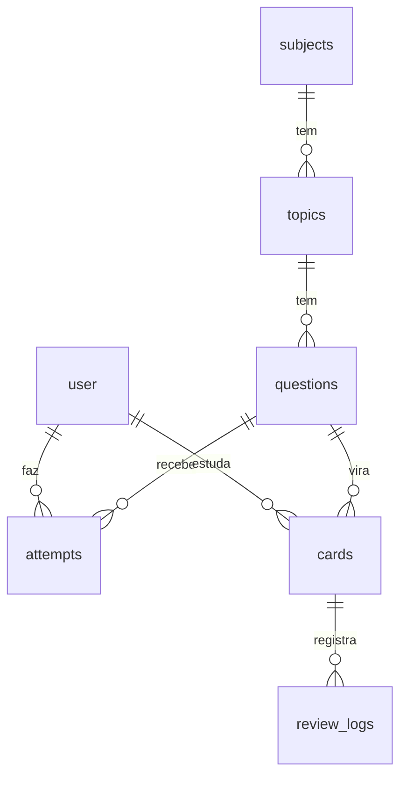

# Synap

Plataforma de estudos para vestibulares e concursos: teoria, questões reais (múltipla escolha e dissertativas) e revisão com repetição espaçada.

> 🚧 Em desenvolvimento. Este repositório contém a base do projeto; as funcionalidades estão no [roadmap](#roadmap).

## Stack

| Camada | Tecnologia |
|---|---|
| Framework | Next.js 15 (App Router) + TypeScript |
| UI | Tailwind CSS 4 + shadcn/ui |
| Banco | PostgreSQL (Neon) + Drizzle ORM |
| Autenticação | Better Auth (e-mail/senha e Google) |
| Repetição espaçada | [FSRS](https://github.com/open-spaced-repetition/ts-fsrs) |
| Testes | Vitest + Playwright |
| CI / Deploy | GitHub Actions + Vercel |

## Arquitetura

```
src/
├── app/                 # rotas Next.js (páginas e API)
│   └── api/auth/        # endpoints do Better Auth
├── components/ui/       # componentes shadcn/ui
├── db/
│   ├── schema/          # tabelas (auth + estudo)
│   └── index.ts         # cliente Drizzle/Neon
└── lib/
    ├── auth.ts          # configuração do Better Auth
    ├── srs/             # repetição espaçada (wrapper do FSRS)
    └── study/           # diagnóstico de desempenho e correção de dissertativas
drizzle/                 # migrations SQL
e2e/                     # testes Playwright
```

### Modelo de dados



- **questions**: múltipla escolha (`options`, `correct_option`) ou dissertativa (`expected_answer`, `rubric`), com banca/vestibular, ano e fonte.
- **attempts**: cada resposta do aluno, usada no diagnóstico.
- **cards / review_logs**: estado do FSRS por aluno e questão, e histórico de revisões.

### Diagnóstico e correção

`src/lib/study` expõe duas funções com assinaturas assíncronas:

- `analisarDesempenho(tentativas)`: taxa de acerto por tópico, pontos fracos (5+ questões e menos de 60% de acerto) e recomendações.
- `corrigirDissertativa(entrada)`: nota ponderada pela rubrica a partir da autoavaliação do aluno.

Hoje funcionam por regras. A ideia é trocar a implementação por IA no futuro sem mudar quem as usa.

## Rodando localmente

Requisitos: Node 22+ e um banco Postgres (o plano grátis do [Neon](https://neon.tech) serve).

```bash
git clone https://github.com/brUnoterraA/Synap.git
cd Synap
npm install
cp .env.example .env    # preencha DATABASE_URL e BETTER_AUTH_SECRET
npm run db:migrate
npm run dev
```

| Script | Descrição |
|---|---|
| `npm run dev` | servidor de desenvolvimento |
| `npm test` | testes unitários (Vitest) |
| `npm run test:e2e` | testes de ponta a ponta (Playwright) |
| `npm run lint` / `npm run typecheck` | ESLint e TypeScript |
| `npm run db:generate` | gera migration a partir do schema |
| `npm run db:migrate` | aplica migrations |
| `npm run db:studio` | interface visual do banco |

## Deploy (grátis)

1. Crie um projeto no [Neon](https://neon.tech) e copie a connection string.
2. Importe o repositório na [Vercel](https://vercel.com/new).
3. Configure as variáveis de ambiente do `.env.example` (com `BETTER_AUTH_URL` apontando para a URL da Vercel).
4. Rode `npm run db:migrate` localmente apontando para o banco do Neon.

## Roadmap

- [x] Base do projeto: banco, autenticação, FSRS, testes e CI
- [ ] Telas de login e cadastro
- [ ] Banco inicial de questões (uma matéria do ENEM)
- [ ] Resolver questões de múltipla escolha
- [ ] Dissertativas com autoavaliação por rubrica
- [ ] Revisão diária com FSRS
- [ ] Painel de desempenho e pontos fracos
- [ ] Conteúdo teórico por tópico
- [ ] Tutor com IA: correção de dissertativas e plano de estudos personalizado

## Licença

[MIT](LICENSE)
